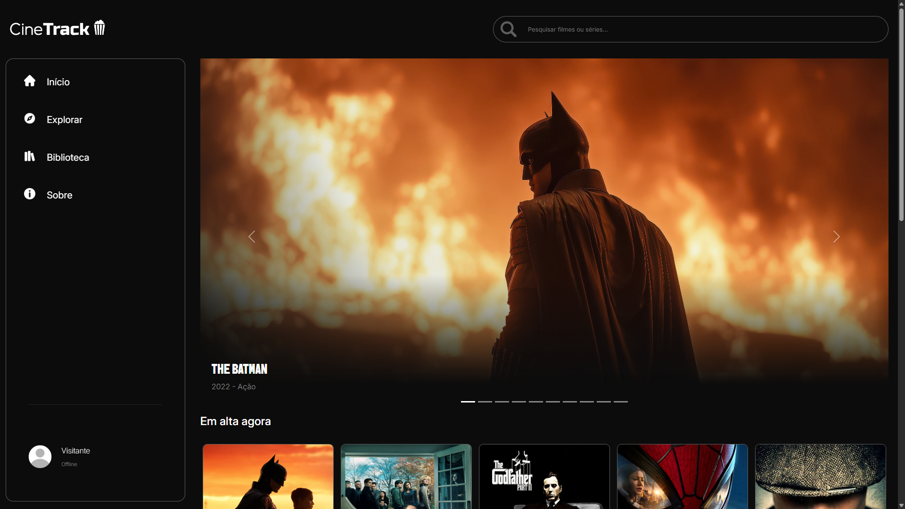
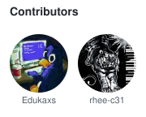

<h1 align="center">CineTrack</h1>

<p align="center">
  
</p>

<p align="center">
  Movie and series tracking platform developed as a school project using PHP and MySQL.
</p>

## About the Project

**CineTrack** is a web platform where users can explore movies and series, check the details of each title, watch trailers, and build a personal library.

The project also aims to put into practice concepts related to **web development, relational databases, SQL, and user authentication**.

## Features

* **Registration and login** with encrypted passwords and session control
* **Home page** with a featured carousel and random rows of trending titles, movies, and series
* **Explore page** with rows by genre (Drama, Comedy, Crime, Action, Adventure, Sci-Fi, and Thriller), mixing movies and series
* **Title page** with featured image, synopsis, director, year, genre, and similar titles
* **Trailer button** that opens the title's trailer in a new tab
* **Personal library** saved in the database, where each user sees only their own titles
* **Duplicate protection:** the same title cannot be added twice to a library
* **Visitor mode:** visitors can browse the site, but must log in to use the library
* **About page** presenting the group and linking to the GitHub organization

## Technologies Used

* **PHP** (PDO) — back-end and database access
* **MySQL / MariaDB** — database
* **HTML5 and CSS3** — pages and layout
* **Bootstrap 5** — carousel and base styles
* **XAMPP** — local development environment (Apache + MySQL)

## Pages

| Page | File | Description |
|---|---|---|
| Home | `index.php` | Featured carousel and rows of trending titles, movies, and series |
| Explore | `explorar.php` | Rows of titles grouped by genre |
| Title | `filme.php?id=` | Details of a movie or series, trailer, and library button |
| Library | `biblioteca.php` | Titles saved by the logged-in user |
| About | `sobre.php` | Information about the group and the project |
| Register / Login | `cadastro.html` / `login.html` | Account creation and authentication |

## Database

The database consists of the following tables:

* `usuarios`
* `filmes`
* `biblioteca`

### The `filmes` Table

Movies and series share the same table. The main columns are:

| Column | Description |
|---|---|
| `titulo` | Title name |
| `tipo` | `filme` (movie) or `serie` (series) |
| `genero` | Genres as text, such as `Drama e Crime`. The Explore rows filter by these words |
| `capa` | Cover file name, stored in `_img/capas/` |
| `destaque` | Featured image file name, stored in `_img/destaque/` |
| `trailer` | Full trailer link (`https://...`) |
| `diretor`, `ano`, `descricao` | Director, year, and synopsis |

> Only the **file names** of the images are stored in the database. The image files stay in the `_img` folders.

### Main Relationships

* A **user** can have multiple titles in their library.
* A **title** can be in the libraries of multiple users.
* The `biblioteca` table links users and titles, and has a `UNIQUE` constraint on `usuario_id` and `filme_id` to prevent duplicates.

## Project Structure

```text
CineTrack/
├── CineTrack/
│   ├── banco.sql
│   └── public/
│       ├── _css/
│       ├── _img/
│       │   ├── capas/
│       │   └── destaque/
│       |
│       ├── _php/
│       │   ├── conexao.php
│       │   ├── cadastro.php
│       │   ├── login.php
│       │   ├── filmes.php
│       │   └── biblioteca_acao.php
│       ├── index.php
│       ├── explorar.php
│       ├── filme.php
│       ├── biblioteca.php
│       ├── sobre.php
│       ├── login.html
│       └── cadastro.html
└── README.md
```

> The folder structure may be modified as the project develops.

## Getting Started

1. Install [XAMPP](https://www.apachefriends.org/).
2. Clone this repository into the `htdocs` folder (for example, `C:\xampp\htdocs\`).
3. Open the XAMPP Control Panel and start **Apache** and **MySQL**.
4. Open `http://localhost/phpmyadmin`, go to the **Import** tab, and import `CineTrack/banco.sql`.
5. Open the site in the browser:

```text
http://localhost/CineTrack/CineTrack/public/index.php
```

> Adjust the address to match the folder name where you cloned the project. Always open the site through `http://localhost`. Opening the files directly (`file:///`) does not run PHP.

The database connection is configured in `CineTrack/public/_php/conexao.php`, which uses the XAMPP defaults (user `root`, no password).

### Adding Titles

Titles are added directly to the `filmes` table. For example:

```sql
INSERT INTO filmes (titulo, tipo, diretor, ano, genero, capa, destaque, trailer, descricao)
VALUES ('Title name', 'serie', 'Director', 2024, 'Drama e Crime',
        'capa-title.png', 'destaque-title.png', 'https://www.youtube.com/watch?v=CODE', 'Synopsis...');
```

Place the cover in `_img/capas/` and the featured image in `_img/destaque/`, using exactly the file names stored in the database.

## Security

* **Prepared statements** (PDO) against SQL injection
* **`password_hash` and `password_verify`** for password storage
* **`htmlspecialchars`** on every value printed in the pages, against XSS
* **Server-side checks** on the library: only logged-in users can add titles, and the title and user are validated before saving

## Planned Improvements

* Individual ratings for each title, used to order the "Trending" rows
* Library status (want to watch, watched, and favorite) and removing titles from the library
* Working search bar
* Logout
* Statistics page

## Academic Objectives

This project was developed to apply practical knowledge of:

* Web development with PHP
* Database modeling, SQL, and relationships between tables
* User authentication and sessions
* Integration between the back-end and the database
* Teamwork and version control with Git and GitHub

## Team

Project collaboratively developed by the members of **CHEB-Labs**, a group of students from **ETEC da Zona Leste (ETEC ZL)**.



The contributions listed above may be updated as the project progresses.

---

Academic Project — **CineTrack**
